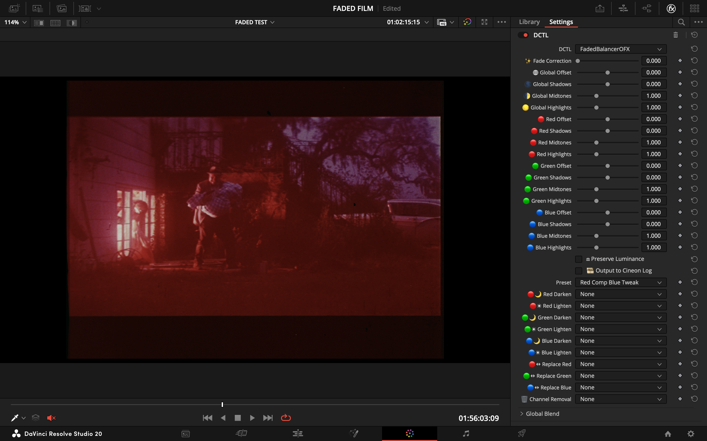
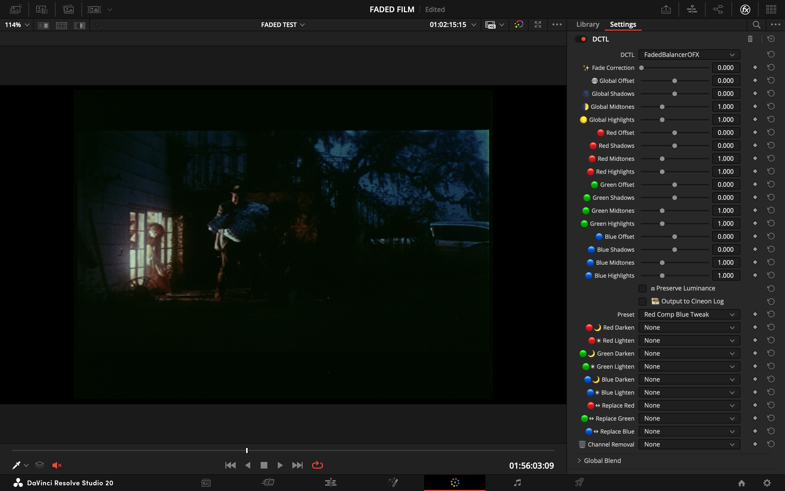
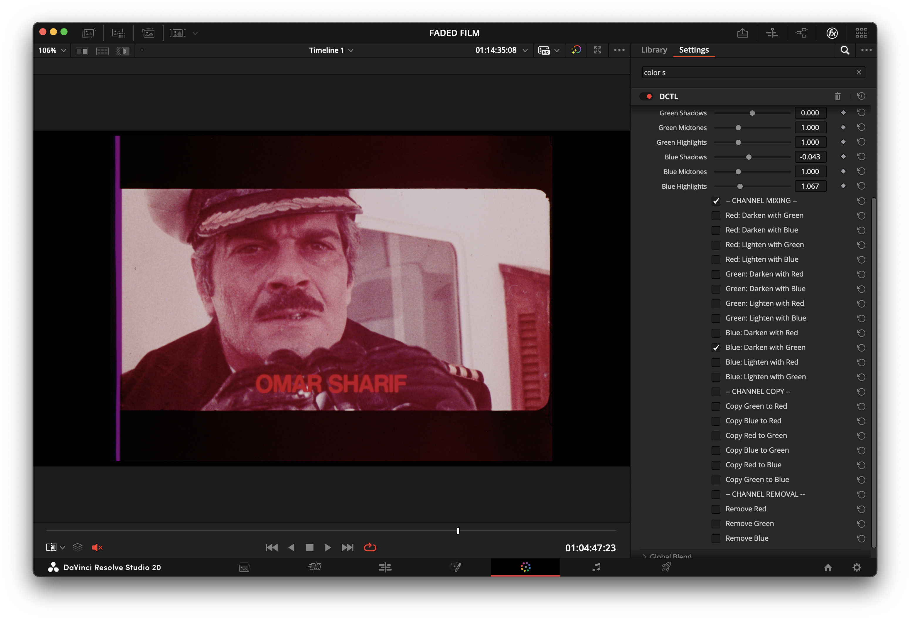
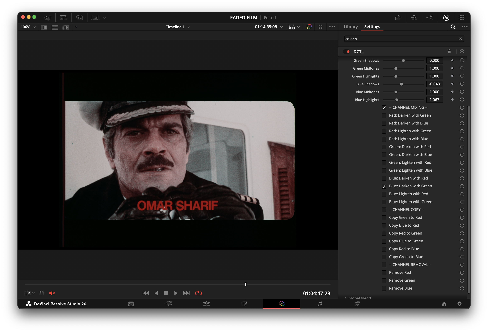
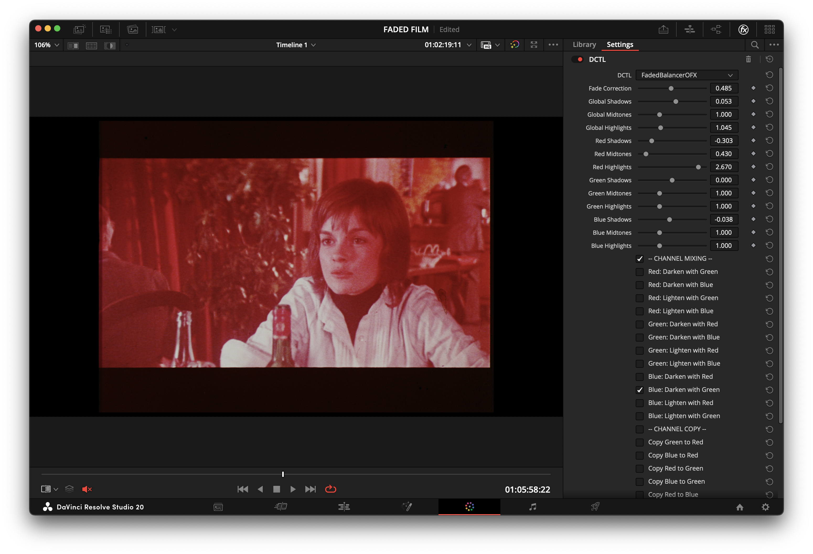
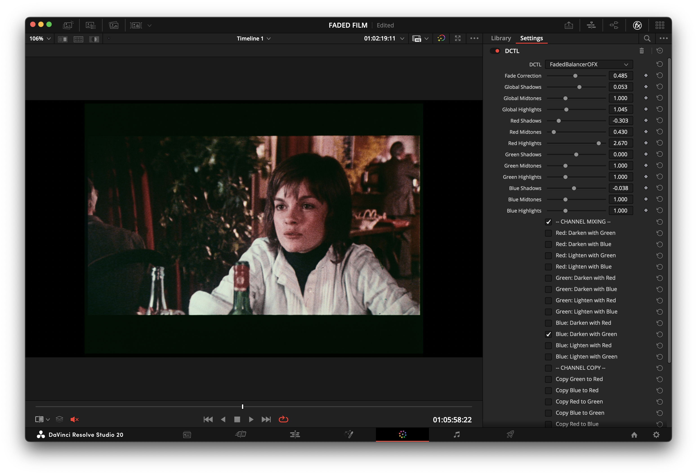

# Faded Balancer DCTL

<p align="center">
  <a href="https://github.com/sponsors/fabiocolor"></a>
  <a href="https://paypal.me/fabiocolor"></a>
</p>

<p align="center">
  
  
</p>

<p align="center">
  <a href="https://github.com/fabiocolor/Faded-Balancer-DCTL/releases/latest">
    
  </a>
  <br/>
  <code>winget install FabioColor.FadedBalancerDCTL</code>
  <br/>
  <small>
    Winget can lag behind a new GitHub release. Until <code>winget show FabioColor.FadedBalancerDCTL</code> reports 1.7.0,
    use the Windows installer from <a href="https://github.com/fabiocolor/Faded-Balancer-DCTL/releases/latest">Latest Release</a>.
  </small>
</p>

<p align="center">
  <a href="docs/CHANNEL_RECOVERY.md">Channel Recovery</a> •
  <a href="docs/BACKGROUND_FILM_FADING.md">Background & Science</a> •
  <a href="docs/presets_companion.md">Presets Companion</a> •
  <a href="docs/FAQ.md">FAQ</a> •
  <a href="https://github.com/fabiocolor/Faded-Balancer-DCTL/discussions">Discussions</a>
</p>

Faded Balancer is a DaVinci Resolve Transform DCTL for balancing RGB channels in faded film scans. It combines an assisted two-point range correction with direct channel controls, additive and min/max channel mixing, presets, and inspection tools.

It is a grading and restoration-preparation tool, not a content-reconstruction system. It can reposition or expand surviving channel information; it cannot recreate detail that is absent, flat, or already clipped before the DCTL.

---

### Version

**Current: v1.7.0**

#### What's New in v1.7.0

- **Progressive Two-Point Channel Recovery:** Pick a neutral dark point first for an immediate black-point alignment, then a neutral bright point to complete a black-anchored stretch of one damaged channel.
- **Conservative Auto selection:** `Auto` acts only when one channel is a clear outlier. Explicit Red, Green, and Blue choices remain available for ambiguous scenes.
- **Single-node sequential calculation:** Both pickers report the DCTL input, so the bright value is passed through the dark correction internally before the gain is calculated.
- **Full-float-safe core math:** Neutral settings preserve negative, zero, in-range, and super-white values. Gamma is sign-preserving, Fade Correction remains monotonic outside its calibrated `0..1` luma interval, and there is no final output clamp.
- **Mixing controls completed:** Mixing Shadows, Mixing Highlights, and Donor Luminance now affect both the additive channel matrix and the min/max Darken/Lighten operations.
- **Predictable multi-channel replacement:** Multiple Replace choices read from one pre-replacement snapshot rather than cascading in UI order.
- **Honest control labels:** Legacy Shadows/Midtones/Highlights labels are now Lift/Gamma/Gain. Lift retains its original additive behavior for saved-grade compatibility; it is mathematically the same response as Offset.
- **Diagnostic output relabeled:** The former Cineon-labelled option is now **Diagnostic Log Preview**. It is a monotonic inspection view, not Cineon and not a delivery transform.
- **Preset Tonal Only opt-out:** The default unchecked state preserves presets' historical Blue Darken with Green request without overriding a manual Blue Darken mode. Enable the checkbox to keep only the tonal recipe.

#### Earlier releases

- **v1.6.0:** Introduced tonal mixing controls and Channel Preview. In v1.7.0, the tonal and donor controls were wired consistently into both mixing paths.
- **v1.5.0:** Introduced the additive cross-channel mixer. It transfers donor-channel structure; it does not reconstruct missing image content.
- **v1.4.0:** Added ten internal starter presets.
- **v1.3.0:** Added Preserve Luminance, Replace operations, and the fixed processing order.
- **v1.2.0:** Removed the final hard clamp and added per-channel Offset. The legacy log-labelled inspection switch from this release was corrected and renamed in v1.7.0.

---

### What the Controls Actually Do

#### Progressive two-point recovery

The recovery stage estimates a reference black and white from the mean of the two non-target channels at two operator-selected neutral samples. It then applies one affine offset-and-gain correction to the selected channel. The target channel's surviving pixel structure is stretched; donor pixels are not copied.

`Auto` is intentionally conservative. It can identify one obviously shifted dark-point outlier after Step 1 and one uniquely compacted or consistently low channel after Step 2. It does not inspect a frame histogram, track objects, infer scene semantics, or guarantee that the provisional Step 1 channel will remain selected after Step 2. See [Channel Recovery](docs/CHANNEL_RECOVERY.md) for the exact calculation and failure conditions.

#### Offset, Lift, Gamma, and Gain

Global and per-channel controls share the same operation order:

```text
x = x + Offset + Lift
x = sign(x) * abs(x)^(1 / Gamma)
x = x * Gain
```

- **Offset** is additive across the whole channel.
- **Lift** is the original legacy additive control and therefore has the same mathematical response as Offset. It is not a shadows-only curve. Its identifier and behavior are retained so existing grades do not silently change.
- **Gamma** is a signed power operation. `1.0` is neutral, and negative input values keep their sign.
- **Gain** multiplies the whole channel. It is not a highlights-only control.

#### Fade Correction

Fade Correction is a deterministic per-pixel contrast-and-chroma nudge. It uses Rec.709-weighted luma, blends toward a smooth S-curve within the normalized `0..1` luma interval, and increases chroma progressively up to `2x` at maximum. It does not measure the image, estimate dye loss, or adapt its settings from frame content.

The curve is safe for floating-point grading: below-black and super-white luma excursions are not folded by the S-curve, and the DCTL does not apply a final clamp. This does not mean every operation leaves out-of-range values unchanged; active grading controls can still move them.

#### Preserve Luminance

Preserve Luminance records Rec.709-weighted luma immediately before the **manual per-channel** Offset/Lift/Gamma/Gain stage and rescales RGB immediately after that stage. It does not preserve luma across presets, global adjustments, Fade Correction, matrix mixing, min/max mixing, Replace, Removal, Channel Preview, or Diagnostic Log Preview.

#### Additive channel matrix

Controls such as **Red from G** add a scaled donor channel into the target channel. For example, Red from G forms a candidate `R + coefficient * G`, then blends toward it through the tonal weight. Negative coefficients subtract donor structure.

This can approximate missing contrast or borrow correlated structure from a healthier record, but it is not spectral recovery and cannot rebuild genuinely absent or clipped detail.

#### Darken and Lighten mixing

Darken selects the lower of the target and adjusted donor values; Lighten selects the higher. The result is blended with the same tonal weight used by the matrix.

The tonal controls are broad, overlapping weights rather than exclusive keys. With bounded Rec.709 luma `L`:

```text
weight = (1 - L²) * Mixing Shadows + L² * Mixing Highlights
```

- Shadows `1`, Highlights `0` gives maximum effect at black and smoothly less toward white.
- Shadows `0`, Highlights `1` gives no effect at black and smoothly more toward white.
- Both at `1` applies full mixing over the whole range.
- **Donor Luminance** scales donor values before both matrix and min/max mixing.

#### Replace, Removal, and Channel Preview

- **Replace** copies one complete channel into another. Multiple replacements are simultaneous, using one shared source snapshot.
- **Removal** sets the selected channel, or all channels, to zero. It is mainly a diagnostic control.
- **Channel Preview** shows Red, Green, or Blue as grayscale after replacement and removal.

#### Diagnostic Log Preview

Diagnostic Log Preview maps positive values with `x / (1 + x)`, maps zero and negative values to zero, and approaches one for very large positive values. It is useful for inspecting positive excursions without a finite hard clip inside the preview curve.

It is **not** Cineon, a color-space conversion, a reversible encoding, or a delivery output. It cannot reveal detail that was clipped upstream. Disable it for normal grading and delivery.

---

### Recommended Workflow

1. Place the DCTL where its input represents the RGB values you intend to balance.
2. Leave Preset at `None` while setting up recovery.
3. Choose `Auto` or an explicit damaged channel, then pick an unclipped neutral dark sample.
4. Pick an unclipped neutral bright sample. Reduce Recovery Strength or Recovery Max Gain if grain, noise, or banding becomes excessive.
5. Try a preset or use manual Offset/Lift/Gamma/Gain controls. Remember that Lift is additive and Gain affects the entire channel.
6. Use matrix or min/max mixing only when another channel contains useful correlated structure. Inspect the result with Channel Preview.
7. Perform final color management, gamut mapping, and legal-range handling elsewhere in the Resolve pipeline.

Presets are starting recipes, not automatic restoration. With **Preset Tonal Only** unchecked, eight presets may request Blue Darken with Green when the visible Blue Darken selector is `None`; enable the checkbox for grading-only preset math. Leaving it unchecked also preserves the behavior of saved pre-v1.7 preset grades. The complete recipes are documented in [Presets Companion](docs/presets_companion.md).

---

### Working Domain and Compatibility

- **Supported Resolve version:** DaVinci Resolve 19.1 or later. This DCTL uses current Transform DCTL UI features and tooltips; older versions are not a supported target.
- **No implicit color-space conversion:** The DCTL operates directly on the node-input RGB code values. It does not know whether those values are log, linear, scene-referred, or display-referred.
- **Best sampling conditions:** Use two genuinely neutral, unclipped areas that belong to the same illumination and material family. Specular highlights, colored shadows, channel clipping, or different illuminants can produce a technically correct but visually wrong endpoint match.
- **Fade Correction calibration:** Its luma S-curve is designed around a normalized `0..1` working interval. Signed Gamma and most other stages remain numerically defined outside that interval, but their creative response will differ between log and linear encodings.
- **Floating point:** With all controls neutral, Preset `None`, Recovery `Off`, and Diagnostic Log Preview disabled, the DCTL is an identity for finite negative, zero, in-range, and super-white RGB values. Active controls may intentionally produce values outside `0..1`; downstream nodes decide how to display or constrain them.

---

### Pipeline (Processing Order)

0. **Progressive Two-Point Channel Recovery**
1. **Preset Pass** — internal values only; optional preset mixing request is applied later
2. **Global Offset / Lift / Gamma / Gain**
3. **Fade Correction**
4. **Per-Channel Offset / Lift / Gamma / Gain**
5. **Optional Preserve Luminance** — around the manual per-channel stage only
6. **Masked Additive Channel Matrix**
7. **Masked Darken / Lighten Mixing**
8. **Simultaneous Replace**
9. **Removal**
10. **Channel Preview**
11. **Optional Diagnostic Log Preview**

---

### Before & After

These examples show possible manual or preset balances. They are examples, not a guarantee that one setting will fit another scan.

| Scene | Before | After |
| :--- | :---: | :---: |
| Night |  |  |
| Boy |  |  |
| Captain |  |  |
| Beach |  |  |
| Table |  |  |

---

### Installation

1. **Windows:** Use `winget install FabioColor.FadedBalancerDCTL` after `winget show FabioColor.FadedBalancerDCTL` reports 1.7.0; otherwise use the latest-release installer below.
2. **Installer ZIP fallback:**
   - **Windows:** Download `FadedBalancerDCTL-Setup-x.x.x-win64.zip` from [Latest Release](https://github.com/fabiocolor/Faded-Balancer-DCTL/releases/latest), extract it, then run the `.exe`.
   - **macOS:** Download `FadedBalancerDCTL-x.x.x-macos.zip` from [Latest Release](https://github.com/fabiocolor/Faded-Balancer-DCTL/releases/latest), extract it, then run the `.pkg`.
3. **Manual `.dctl` fallback:** Download `FadedBalancerDCTL.dctl` from the [latest release](https://github.com/fabiocolor/Faded-Balancer-DCTL/releases/latest/download/FadedBalancerDCTL.dctl) and place it in:
   - **Windows:** `C:\ProgramData\Blackmagic Design\DaVinci Resolve\Support\LUT\`
   - **macOS:** `/Library/Application Support/Blackmagic Design/DaVinci Resolve/LUT/`
4. Restart Resolve or refresh the DCTL list.
5. On the Color page, add a DCTL effect and select `FadedBalancerDCTL`.

See the [installation guide](docs/INSTALL.md).

---

### Sample Footage and Demonstration

- [Archive.org — Film BAR: 70 Trailers Reel (1440x1080, 24fps)](https://archive.org/details/film-bar-70-trailers-reel-1440x-1080-24fps)
- [Faded Balancer video tutorial](https://youtu.be/ATPkq5BHs-A) — the UI has evolved since earlier releases; use the current control descriptions in this README for v1.7.0 behavior.

---

### Community & Support

- **Discussions:** [GitHub Discussions](https://github.com/fabiocolor/Faded-Balancer-DCTL/discussions)
- **Contact:** [Email](mailto:info@fabiocolor.com), [Instagram](https://www.instagram.com/fabiocolor), [LinkedIn](https://www.linkedin.com/in/fabiobedoya/), or [YouTube](https://www.youtube.com/@fabiocolor)

If you find the tool useful, you can support its continued development through [GitHub Sponsors](https://github.com/sponsors/fabiocolor) or [PayPal](https://paypal.me/fabiocolor).

---

### Acknowledgements

The Film Fade Correction feature was partially inspired by Trumpy, G., Flueckiger, B., & Goeth, A. (2023), *Digital Unfading of Chromogenic Film Informed by Its Spectral Densities*. [Read the paper](https://ntnuopen.ntnu.no/ntnu-xmlui/handle/11250/3101572).

The implementation here is a lightweight deterministic grading curve; it does not implement the paper's measurement-informed spectral method.

---

### License

[MIT License](LICENSE)
