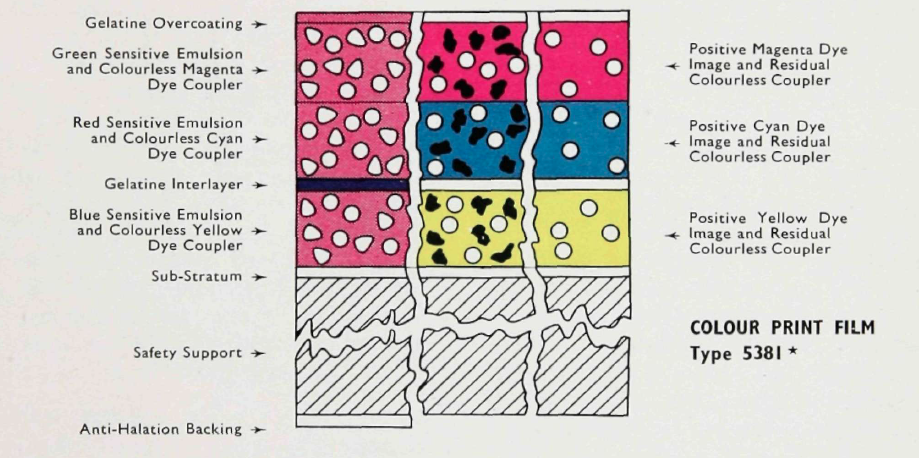

# Faded Balancer DCTL — Background & Science

<p align="center">
  <a href="../README.md">Home</a> •
  <a href="CHANNEL_RECOVERY.md">Channel Recovery</a> •
  <a href="presets_companion.md">Presets Companion</a> •
  <a href="FAQ.md">FAQ</a>
</p>

---

### Why chromogenic film fades

Most color motion-picture film is chromogenic: exposure and development form cyan, magenta, and yellow dyes in separate emulsion layers. Those organic dyes do not age at identical rates. Storage temperature, humidity, processing quality, stock, and time can alter density and contrast differently in each dye record.

The diagram below shows the layer structure of Eastman Color Print Film Type 5381.



*Source: Craig Eastman (1953), Plate 2b. More historical diagrams are available in the [Eastman Color gallery on filmcolors.org](https://filmcolors.org/galleries/eastmancolor-illustrations/).*

| Light-sensitive record | Complementary image dye |
| :---: | :---: |
| Blue | Yellow |
| Green | Magenta |
| Red | Cyan |

Many Eastman Color prints from the 1950s through the early 1980s exhibit the familiar pink or magenta fade. Cyan and yellow dye losses can leave the magenta record comparatively dominant. The exact failure is stock- and storage-dependent, however; not every faded scan has the same damaged RGB channel, and a scanner's RGB channels are not a one-to-one measurement of the original dye layers.


### What digital balancing can and cannot recover

If a damaged record still contains contrast but occupies a shifted or compressed range, digital grading can expand that surviving structure. If a record is flat, clipped, chemically absent, or buried below quantization and noise, its original detail is not recoverable from that channel alone.

Faded Balancer therefore uses the word **recovery** in a limited signal-processing sense: repositioning and expanding surviving channel information. Channel borrowing can create a plausible approximation, but it cannot prove or recreate the original spectral colors.

### Corrective strategies in Faded Balancer

#### 1. Progressive two-point channel recovery

The operator selects a neutral dark sample and a neutral bright sample. For one target channel, the other two channels provide averaged reference endpoints. Step 1 applies the black-point offset immediately; Step 2 adds a gain around that corrected black point.

This is assisted endpoint matching, not automatic frame analysis. `Auto` conservatively chooses one clear channel outlier from the supplied samples. It does not calculate a histogram, identify neutral objects, infer illuminants, or track the correction across shots. Ambiguous samples intentionally produce no change.

The method is most appropriate when:

- one RGB channel retains recognizable tonal structure;
- its sampled range is narrower or consistently lower than the other two;
- the chosen areas are genuinely neutral, unclipped, and under the same illumination; and
- the required gain is moderate enough not to expose unacceptable noise or banding.

See [Progressive Two-Point Faded-Channel Recovery](CHANNEL_RECOVERY.md) for the equation and fail-closed rules.

#### 2. Direct channel balance

Global and per-channel Offset, Lift, Gamma, and Gain allow deterministic manual balancing. The labels describe the control family, but the exact legacy math matters:

```text
x = x + Offset + Lift
x = sign(x) * abs(x)^(1 / Gamma)
x = x * Gain
```

Lift is an additive legacy control with the same response as Offset; it is not isolated to shadows. Gain multiplies the whole signal rather than only highlights. Gamma is a signed power curve, so negative values remain defined.

These controls can reduce a dominant channel, open a compressed channel, or refine the result of two-point recovery. They do not distinguish dye fading from intentional scene color.

#### 3. Deterministic Fade Correction

Fade Correction is a lightweight per-pixel curve, not an image-analysis algorithm. It calculates Rec.709-weighted luma, blends the normalized `0..1` portion toward a smooth S-curve, and increases chroma progressively as the slider rises. At maximum, the chroma multiplier reaches `2x`.

Its purpose is to counter a washed-out appearance after the channel balance is broadly under control. Because it does not estimate the scan's dye densities, it should be judged visually and on scopes. It may over-saturate noise or already healthy colors.

The bounded contrast curve does not fold below-black or super-white luma, and the DCTL has no final hard clamp. That numerical safety is not equivalent to recovering clipped content.

#### 4. Channel borrowing

The additive matrix controls transfer donor-channel structure into a target channel. Darken and Lighten choose the lower or higher of a target and donor. Mixing Shadows and Mixing Highlights provide broad overlapping luma weights, while Donor Luminance scales the donor before both operations.

These techniques work best when records are spatially correlated—for example, when a healthy channel still contains edge or highlight structure that is weak in the target. They are approximations. A donor channel responds to different scene spectra, so added structure can also create false color, halos in chromatic edges, or an unnatural monochromatic relationship.

Replace is more drastic: it substitutes an entire donor record. It removes a cast reliably but also removes genuine channel differences. Multiple replacements are simultaneous, so their result does not depend on selector order.

### Working-domain implications

Faded Balancer performs no color-space conversion. Every equation acts on the RGB values entering its node. A value of `0.5` has different physical and perceptual meaning in log, scene-linear, and display-referred encodings, so the same control setting will not look identical in each domain.

For repeatable results:

1. Choose the DCTL's node position before taking recovery samples.
2. Keep dark and bright samples unclipped in every channel.
3. Use scopes and Channel Preview to confirm that the target really contains structure.
4. Treat Fade Correction as calibrated around normalized `0..1` luma.
5. Keep final color management, gamut mapping, and delivery-range handling in dedicated pipeline steps.

Faded Balancer DCTL v1.7.0 targets DaVinci Resolve 19.1 or later.

### Relation to measurement-informed restoration

The project was partially inspired by Trumpy, G., Flueckiger, B., & Goeth, A. (2023), *Digital Unfading of Chromogenic Film Informed by Its Spectral Densities*. [Read the paper](https://ntnuopen.ntnu.no/ntnu-xmlui/handle/11250/3101572).

That research context should not be confused with this implementation. Faded Balancer does not measure film spectra, fit dye-density models, or implement the paper's complete method. It provides practical per-pixel grading tools that fit within a Transform DCTL.

<p align="center">
  <a href="../README.md">Back to Home</a>
</p>
