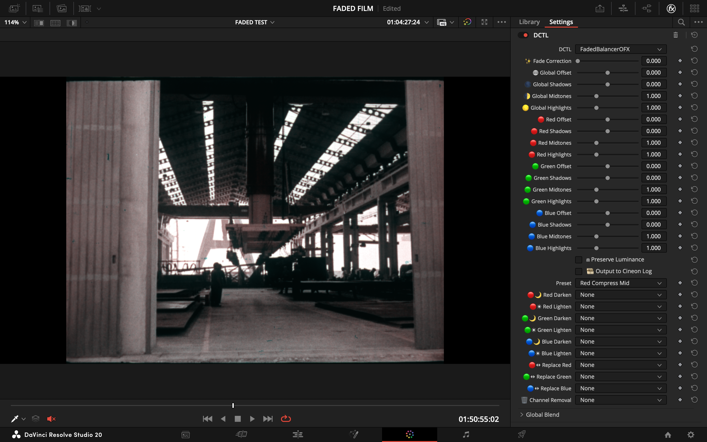
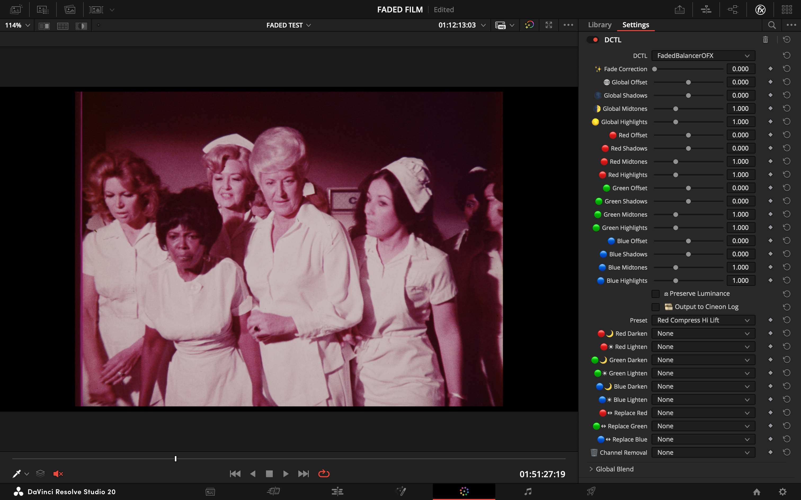
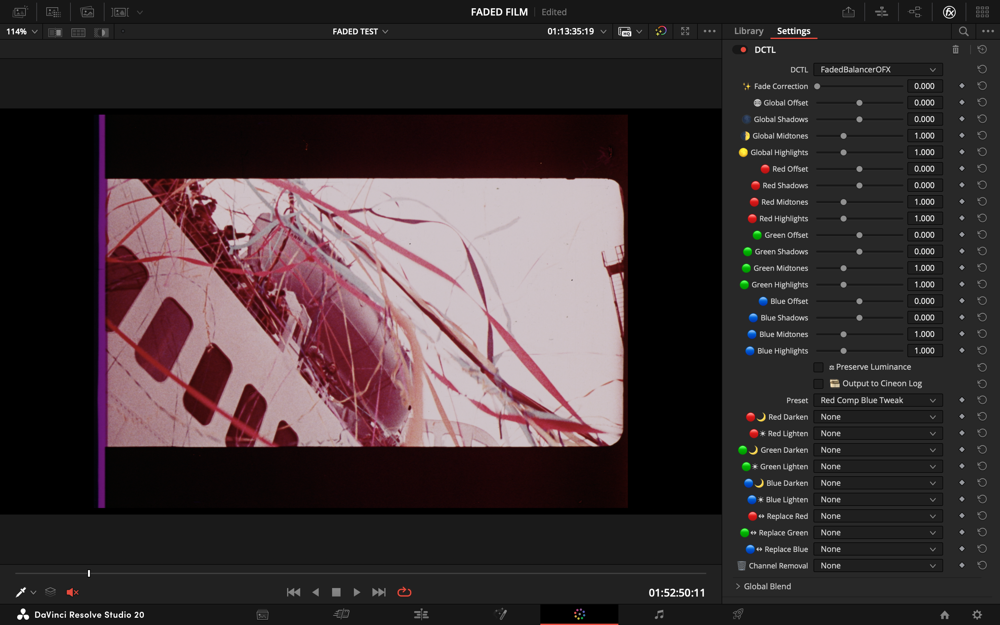
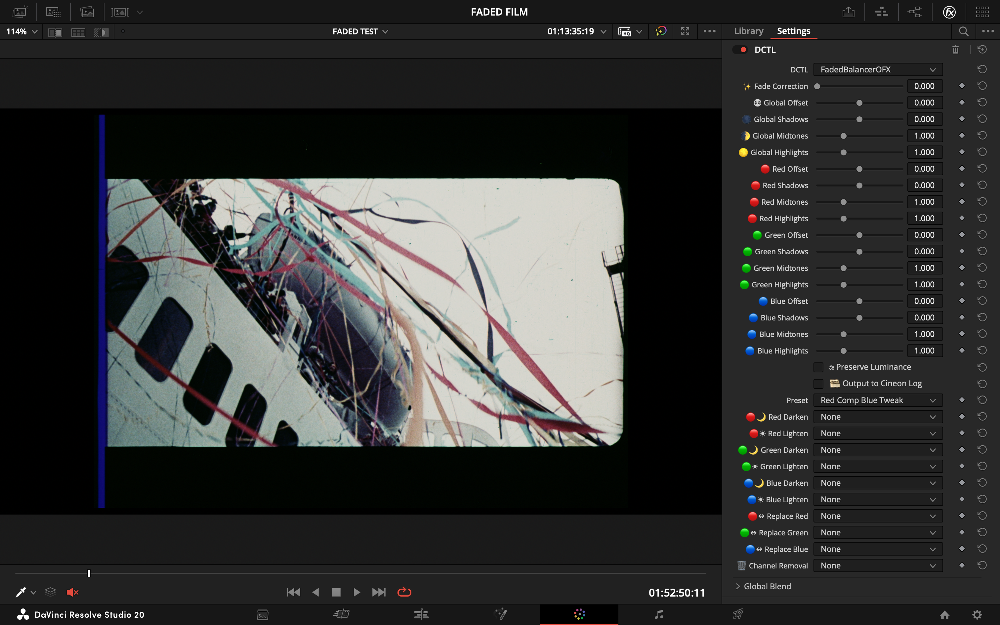
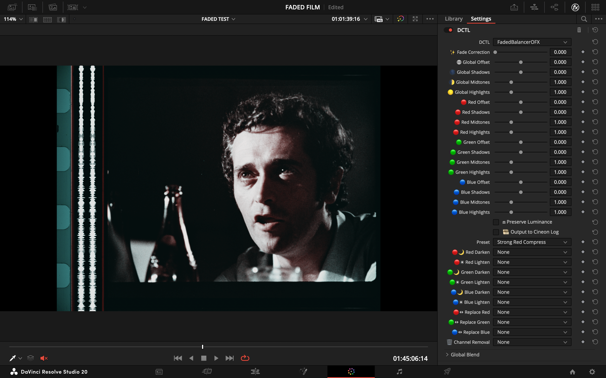
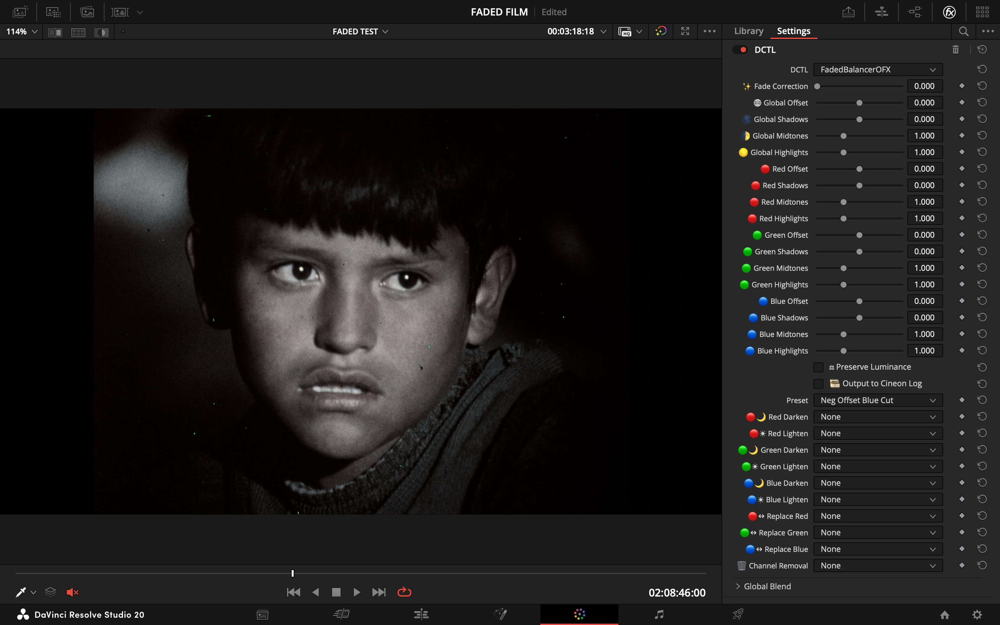
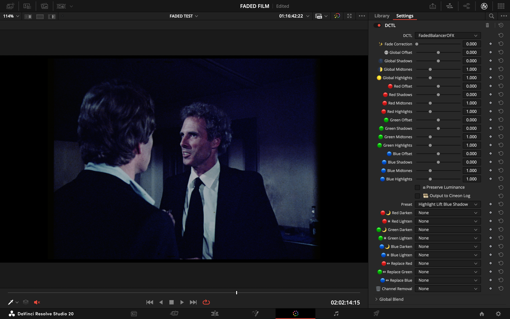
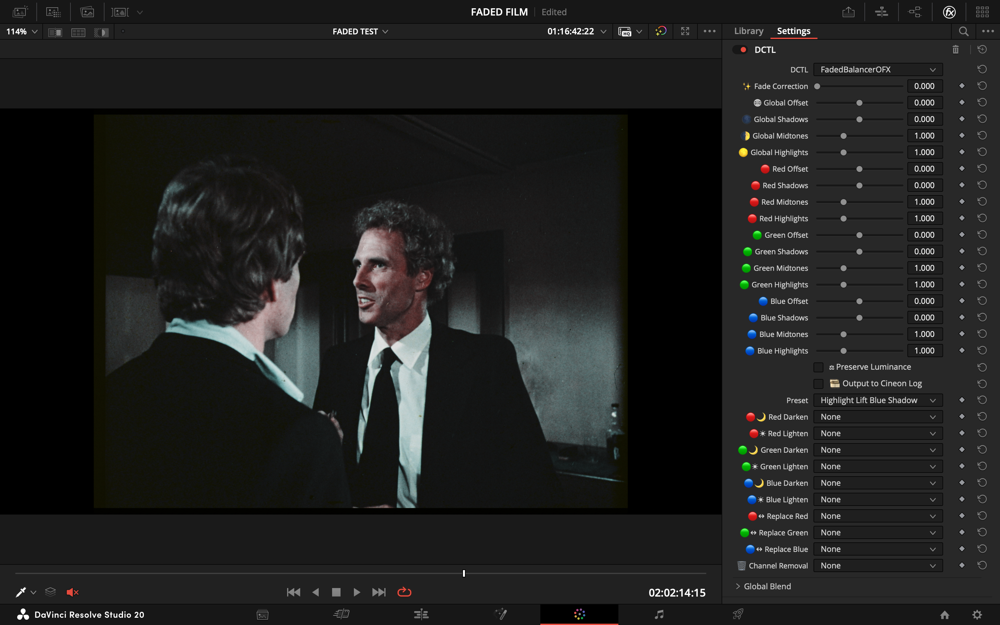

# Faded Balancer DCTL — Presets Companion

<p align="center">
  <a href="../README.md">Home</a> •
  <a href="CHANNEL_RECOVERY.md">Channel Recovery</a> •
  <a href="BACKGROUND_FILM_FADING.md">Background & Science</a> •
  <a href="FAQ.md">FAQ</a>
</p>

---

### What a preset is

The ten presets are fixed internal recipes derived from example faded scans. They do not inspect the current frame and they do not move Resolve's DCTL sliders. Selecting `None` removes the internal preset pass while leaving every visible control untouched.

The preset pass runs after Progressive Two-Point Recovery and before the visible Global controls, Fade Correction, and visible per-channel controls. Each preset applies one internal global Offset/Lift/Gamma/Gain pass followed by one internal per-channel pass.

The control math is:

```text
x = x + Offset + Lift
x = sign(x) * abs(x)^(1 / Gamma)
x = x * Gain
```

Consequently:

- **Lift is legacy additive math identical in response to Offset**, not a shadows-only operation.
- **Gamma** is signed power; values below `1.0` bend normalized positive mid-range values downward.
- **Gain** multiplies the entire channel, not only highlights.
- No preset activates Fade Correction, Preserve Luminance, the additive matrix, Replace, Removal, Preview, or Diagnostic Log Preview.

Preset names are retained for continuity with prior releases. Where a historical name says “Lift,” “Compress,” or “Crush,” use the exact recipe below as the authoritative description.

### Preset mixing assist and Preset Tonal Only

Eight presets also request **Blue Darken With Green**. With **Preset Tonal Only** unchecked (the default), that request is applied only when the visible Blue Darken selector is `None`. A visible manual selection always wins. Enable Preset Tonal Only to run only the preset's internal Offset/Lift/Gamma/Gain recipe.

The opt-out is deliberately unchecked by default. Resolve initializes newly added checkboxes to zero when an older saved node is upgraded, so this polarity preserves the pre-v1.7 preset result instead of silently removing its mixing request.

The request is processed later in the min/max mixing stage and uses the current Mixing Shadows, Mixing Highlights, and Donor Luminance settings. It is not baked into the preset tonal pass. `Red Comp Blue Tweak` and `Neutral Red Mid Tweak` make no mixing request.

### Exact v1.7.0 recipes

Abbreviations: `O` = Offset, `L` = legacy additive Lift, `Γ` = Gamma, `G` = Gain. Omitted controls are neutral (`O/L = 0`, `Γ/G = 1`). Values are the embedded DCTL constants, not suggested slider positions.

| Preset | Global pass | Red pass | Green pass | Blue pass | Mixing request |
| :--- | :--- | :--- | :--- | :--- | :--- |
| Red Compress Mid | O `+0.090`, G `0.920` | Γ `0.437`, G `1.426` | Neutral | Neutral | Blue Darken with Green |
| Balanced Aggregate | O `+0.035` | Γ `0.325`, G `1.269` | Neutral | Neutral | Blue Darken with Green |
| Red Compress Hi Lift | O `+0.043`, G `1.112` | Γ `0.212`, G `1.269` | Neutral | Neutral | Blue Darken with Green |
| Red Comp Blue Tweak | G `1.089` | Γ `0.280`, G `1.224` | Neutral | L `-0.050` | None |
| Heavy Red Crush | O `+0.074`, G `0.887` | O `-0.229`, L `-0.500`, Γ `1.471`, G `3.000` | G `0.954` | Neutral | Blue Darken with Green |
| Mild Corrective | O `+0.097`, G `0.842` | Γ `0.325` | Neutral | G `1.067` | Blue Darken with Green |
| Neutral Red Mid Tweak | O `-0.043` | Γ `0.617`, G `1.224` | Neutral | Neutral | None |
| Strong Red Compress | O `+0.120`, G `0.864` | L `+0.004`, Γ `0.235`, G `1.426` | Neutral | Neutral | Blue Darken with Green |
| Neg Offset Blue Cut | O `-0.167`, G `1.067` | Γ `0.235`, G `1.629` | Neutral | L `-0.260`, G `1.179` | Blue Darken with Green |
| Highlight Lift Blue Shadow | O `+0.035`, G `1.200` | Neutral | Neutral | L `-0.080`, G `1.060` | Blue Darken with Green |

### What each recipe is intended to try

#### Red Compress Mid

Applies a positive global offset followed by a slight global gain reduction. The red channel receives a strong Gamma-below-one bend and compensating Gain-above-one multiply. With assist enabled, blue is later limited by green wherever the weighted Blue Darken operation has an effect.

| Before | After |
| :---: | :---: |
|  |  |

#### Balanced Aggregate

Despite its historical name, this is one fixed recipe; it does not average the image or combine strategies at runtime. It applies a small global positive offset, a strong red Gamma bend, red gain compensation, and the optional Blue Darken with Green request.

| Before | After |
| :---: | :---: |
|  |  |

#### Red Compress Hi Lift

Applies a positive global offset and whole-range global Gain of `1.112`, plus the strongest red Gamma-below-one bend in the preset set and red Gain `1.269`. The name is historical: it does **not** apply Red Lift. Its “high lift” is a whole-range global Gain increase. It also requests Blue Darken with Green.

| Before | After |
| :---: | :---: |
|  |  |

#### Red Comp Blue Tweak

Applies global Gain `1.089`, a strong red Gamma bend with red Gain `1.224`, and a blue additive Lift of `-0.050`. It reduces blue before the signed power stage; it does not boost blue midtones. This preset does not request channel mixing.

| Before | After |
| :---: | :---: |
|  |  |

#### Heavy Red Crush

This is the most aggressive and least general recipe. After a global positive offset and Gain reduction, red receives a combined additive shift of `-0.729`, Gamma `1.471`, and Gain `3.000`; green receives Gain `0.954`. It is not a uniform red darkening curve, and signed out-of-range values are possible. Blue Darken with Green is requested when assist is enabled.

| Before | After |
| :---: | :---: |
|  |  |

#### Mild Corrective

Applies global Offset `+0.097` and Gain `0.842`, a red Gamma bend, blue Gain `1.067`, and the optional Blue Darken with Green request. It does **not** activate Fade Correction. “Mild” describes the source recipe's intended use, not a guaranteed low-strength result on every encoding.

| Before | After |
| :---: | :---: |
|  |  |

#### Neutral Red Mid Tweak

Applies global Offset `-0.043`, red Gamma `0.617`, and red Gain `1.224`. It makes no Blue Darken request. The name is relative to the scan it was derived from; the recipe does not calculate neutrality.

| Before | After |
| :---: | :---: |
|  |  |

#### Strong Red Compress

Applies global Offset `+0.120` with Gain `0.864`, then a small additive red Lift of `+0.004`, a strong red Gamma bend, and red Gain `1.426`. It requests Blue Darken with Green. This combination is nonlinear and not simply a highlight compressor.

| Before | After |
| :---: | :---: |
|  |  |

#### Neg Offset Blue Cut

Applies a negative global Offset of `-0.167`—which lowers code values, not lifts them—followed by global Gain `1.067`. Red receives Gamma `0.235` and Gain `1.629`; blue receives additive Lift `-0.260` and Gain `1.179`. It requests Blue Darken with Green and can produce below-black values.

| Before | After |
| :---: | :---: |
|  |  |

#### Highlight Lift Blue Shadow

Applies global Offset `+0.035` and whole-range global Gain `1.200`, then blue additive Lift `-0.080` and blue Gain `1.060`. Its historical “Highlight Lift” is implemented as Gain, not a highlight-isolated operation. It also requests Blue Darken with Green.

| Before | After |
| :---: | :---: |
|  |  |

### Using presets responsibly

1. Evaluate recovery first, because it runs before the preset pass.
2. Toggle Preset Tonal Only to hear the recipe with and without its optional min/max operation.
3. Watch RGB parade, waveform, and Channel Preview. A recipe derived in one encoding may be too strong in another.
4. Refine with the visible controls, which run after the internal preset pass.
5. Return Preset to `None` when you need a fully manual grade.

Presets do not guarantee neutrality, preserve final luminance, protect gamut, or restore absent color. They are reproducible starting points.

<p align="center">
  <a href="../README.md">Back to Home</a>
</p>
